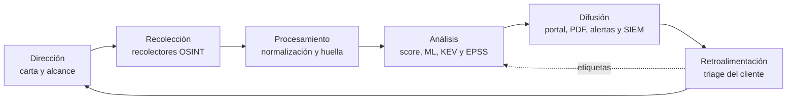

# Etapa 4 · Ciberinteligencia en LowTide

Sección de la Etapa 4 para el documento integrado de Etapas (#59). Explica cómo LowTide aplica el ciclo de inteligencia, qué produce que se parece a un indicador de compromiso (IOC) y cómo sus reglas se ubican en MITRE ATT&CK. Tarjeta #58 (RC-106). La otra tarjeta de la Etapa 4 es #58b (RC-153, pruebas de penetración).

> LowTide **mide exposición, no compromiso**. Encuentra lo que un adversario vería de una empresa desde internet antes de atacarla. No detecta intrusiones ni actividad maliciosa dentro de la red del cliente.

## 1. El ciclo de inteligencia con las piezas reales de LowTide

| Fase | Qué hace LowTide | Dónde está |
|---|---|---|
| **Dirección** (qué se necesita saber y con qué permiso) | Solo se analizan dominios con una carta de autorización firmada y vigente y con el registro TXT verificado. La carta fija el alcance y las actividades permitidas (Anexo A) | `cirdan/alcance_carta.py`, `cirdan/cartas.py`, `docs/plantilla_carta_autorizacion.md`, `docs/politica_uso_etico.md` |
| **Recolección** | Recolectores pasivos de fuentes abiertas: certificados (crt.sh y Cert Spotter), DNS y correo (SPF y DMARC), RDAP, servicios e IoT/OT vistos por Shodan InternetDB, secretos y correos en GitHub, brechas en HIBP, la visita a la portada y la documentación de APIs. Cada uno cumple el contrato de plugin: filtro de alcance, reintentos y respuestas grabadas | `cirdan/recolectores/`, `docs/contrato_plugin.md` |
| **Procesamiento** | El orquestador normaliza lo que devuelve cada fuente, lo deduplica por huella (sha256 de lo observado) y lo guarda como activos y hallazgos de la empresa, con RLS por empresa | `cirdan/orquestador/` |
| **Análisis** | El motor de score pondera cada hallazgo por categoría y severidad, con regla de piso para los críticos. El clasificador supervisado (con explicación SHAP) y el modelo de anomalías semanales ajustan la severidad. CISA KEV y EPSS priorizan las CVE que se explotan en el mundo (#69, RC-127, PR #304 en revisión) | `cirdan/score/`, `cirdan/ml/`, `cirdan/inteligencia/` (PR #304) |
| **Difusión** | El portal (tablero, hallazgos, plan de acción y simulador), el reporte ejecutivo y el técnico en PDF, el resumen semanal, las alertas por umbral de score y la exportación al SIEM (Splunk) | FrontKL, `cirdan/reporte.py`, `cirdan/reporte_tecnico.py`, `cirdan/siem/` |
| **Retroalimentación** | El cliente marca cada hallazgo como falso positivo, riesgo aceptado o resuelto (#80, RC-133). Los falsos positivos salen del score y quedan como etiquetas para reentrenar el clasificador. El tiempo medio de remediación mide si el ciclo funciona | `cirdan/triage.py` y `GET /domains/{fqdn}/remediation` (PR #305 en revisión) |

## 2. Exposición, no compromiso: lo que se parece a un IOC

Un IOC es evidencia de que un sistema **ya fue comprometido**: un hash de malware, una IP de comando y control o un dominio usado en una campaña. LowTide no ve dentro de la red del cliente, así que no produce IOC en ese sentido. Sí produce datos que el equipo de defensa puede usar como indicadores, ubicados en la Pirámide del Dolor:

| Lo que produce LowTide | Regla | Nivel en la Pirámide del Dolor | Cómo se usa en defensa |
|---|---|---|---|
| Dominios parecidos ya registrados | `lookalike_domain` (#109, RC-226) | Nombres de dominio | Bloquearlos en el correo y en el proxy del cliente antes de que lleguen las campañas de phishing |
| IP públicas de la empresa vistas por InternetDB | `exposed_service`, `exposed_rdp` y relacionadas (#17) | Direcciones IP (trivial) | Inventario de lo expuesto. Cerrar lo que no debía estar en internet |
| Huellas de secretos expuestos en repos públicos | `secret_in_public_repo` (#16) | Artefactos | Rotar la credencial. La huella permite saber si vuelve a aparecer |
| Correos de la empresa en brechas | `breach_exposure` (#19, RC-54) | Indicio de credenciales, no IOC técnico | Forzar el cambio de contraseña y activar MFA en esas cuentas |

Por las 4 categorías de la tarea "IOCs y mecanismos de defensa": LowTide da indicadores **atómicos** (dominios, IP, huellas). No da indicadores de **host** ni **comportamentales**, porque no tiene agentes ni ve tráfico. De **red** da solo lo que se ve desde fuera: puertos y servicios publicados.

## 3. Mapeo a MITRE ATT&CK

Cada regla de LowTide tiene su mapeo a ATT&CK Enterprise v19, ISO/IEC 27001:2022 y CIS Controls v8.1 en `scoring_rule_framework_mappings` (migraciones 011 y 012, #68, RC-131). La API lo da en `frameworks.mitre_attack` de cada hallazgo. Una regla lleva técnica solo cuando la descripción de la técnica nombra lo que la regla detecta como algo que un adversario busca, adquiere o usa. Si no, va sin técnica y con la razón.

De las 40 reglas, 30 tienen técnica, en 15 técnicas distintas. 10 de las 15 son de **Reconocimiento** (TA0043) y **Desarrollo de recursos** (TA0042), lo que un adversario hace antes del acceso inicial. Las demás son de acceso inicial (T1133 y T1190), de credenciales (T1552.001), de recolección (T1530) y de suplantación de correo (T1684.002):

| Técnica | Nombre | Reglas de LowTide |
|---|---|---|
| T1589.001 | Recopilar credenciales de la víctima | `breach_exposure`, `breach_exposure_old` |
| T1589.002 | Recopilar correos de la víctima | `breach_exposure_no_passwords`, `email_in_public_commits`, `personal_email_exposed` |
| T1589.003 | Recopilar nombres de empleados | `email_pattern_exposed` |
| T1592.002 | Recopilar el software de la víctima | `debug_page_exposed`, `server_version_disclosed` |
| T1593.003 | Buscar en repositorios de código públicos | `file_share_link_in_repo`, `secret_in_public_repo` |
| T1596.003 | Buscar en certificados digitales | `cert_internal_name` |
| T1596.005 | Buscar en bases de datos de escaneos | `exposed_database`, `exposed_file_sharing`, `exposed_iot_device`, `exposed_ot_device`, `exposed_service` |
| T1583.001 | Adquirir dominios | `domain_expiring_soon`, `lookalike_domain` |
| T1584.001 | Tomar dominios o subdominios | `subdomain_takeover_risk` |
| T1588.004 | Obtener certificados digitales | `cert_new_issuer` |
| T1684.002 | Suplantación de correo | `dmarc_missing`, `dmarc_policy_none`, `spf_allow_all`, `spf_missing` |
| T1133 | Servicios remotos externos | `exposed_container_api`, `exposed_rdp`, `exposed_remote_admin` |
| T1190 | Explotar una aplicación expuesta a internet | `known_vulnerability` |
| T1530 | Datos en almacenamiento en la nube | `public_bucket` |
| T1552.001 | Credenciales en archivos | `secret_in_container_image` |

Sin técnica (10): `api_auth_not_declared`, `cert_broad_wildcard`, `cert_expired`, `cert_expiring_soon`, `directory_listing`, `exposed_ai_service`, `exposed_api_docs`, `outdated_software`, `tls_certificate_invalid` y `tls_legacy_only`. Son debilidades de configuración que ninguna técnica nombra de forma directa.

### Capa de ATT&CK Navigator

[`attack_navigator_lowtide.json`](attack_navigator_lowtide.json) es la capa para [ATT&CK Navigator](https://mitre-attack.github.io/attack-navigator/) (Open Existing Layer > Upload from local). Colorea cada técnica por el número de reglas que la detectan y lista esas reglas en el comentario. Sale de las migraciones con `python -m cirdan.navigator --escribir`, y `pruebas/test_navigator.py` revisa en el CI, sin red, que el archivo coincida con las migraciones 011 y 012 y las que agregaron reglas después.

## 4. Otros modelos del curso (propuesta)

Propuesta del comentario del 5 nov (NetAcad CyberOps, módulos 22 y 28). Sin código nuevo:

- **Cyber Kill Chain**: LowTide hace, con permiso, lo que el adversario hace en la fase de **reconocimiento** con información pública. Cada hallazgo se ubica en la fase que le facilitaría al adversario: los dominios parecidos y un DMARC a medias en la **entrega**, y una CVE en KEV o un RDP expuesto en la **explotación**.
- **Modelo de Diamante**: LowTide llena el vértice de **víctima** (la superficie expuesta) y parte del de **infraestructura** (dominios parecidos ya registrados).
- **Superficies de ataque de SANS**: **red** (puertos de InternetDB), **software** (tecnologías y CVE) y **humana** (correos en brechas, cuando HIBP está activo).

## Evidencia

- Este documento y la capa están en el repositorio de BackKL. El enlace al borrador en la carpeta compartida va en el comentario de RC-106.
- No necesita la VM: todo sale del repositorio.
